# OctaPDF

<p align="center">
  <a href="#quickstart">
    
  </a>
</p>

<p align="center">
  <strong>Powerful PDF tools. Beautifully simple.</strong><br>
  A calm, private, local-first document workspace for editing, organizing, converting, and securing PDFs.
</p>

<p align="center">
  <a href="https://github.com/DecoyINDIA/OctaPDF/releases"></a>
  <a href="https://github.com/DecoyINDIA/OctaPDF/blob/main/LICENSE"></a>
  <a href="#zero-egress-architecture"></a>
  <a href="https://hub.docker.com/"></a>
  <a href="https://adoptium.net/"></a>
</p>

<p align="center">
  <a href="#why-octapdf">Why OctaPDF</a> &bull;
  <a href="#universal-intake-deck">Intake Deck</a> &bull;
  <a href="#the-four-core-document-jobs">4 Core Jobs</a> &bull;
  <a href="#command-palette">Command Palette</a> &bull;
  <a href="#zero-egress-architecture">Architecture</a> &bull;
  <a href="#pipeline-automation">Pipelines</a> &bull;
  <a href="#quickstart">Quickstart</a> &bull;
  <a href="#production-deployment">Deployment</a> &bull;
  <a href="#the-paper-desk-design-system">Design System</a> &bull;
  <a href="#license">License</a>
</p>

<p align="center">
  
</p>

## Product Identity & Philosophy

<p align="center">
  
</p>

### Why OctaPDF?

OctaPDF is engineered for people who work with documents every day and value **privacy, precision, and craft**.

Instead of routing sensitive agreements, healthcare records, tax returns, or confidential drafts through third-party cloud SaaS converters, OctaPDF runs entirely on your local workstation or isolated private network. **Your files never leave your control.**

```
+---------------------------------------------------------------------------------+
|                               THE OCTAPDF PRINCIPLES                            |
+---------------------------------------------------------------------------------+
|  1. 100% Local-First Engine    | Zero telemetry. Zero tracking pixels. Zero    |
|                                | third-party phone-home calls. Ever.            |
|  2. The Paper Desk Aesthetic   | Warm eggshell tones, obsidian dark mode, crisp |
|                                | typography, and thoughtful tactile micro-UX.   |
|  3. Universal Intake Deck      | Drop any PDF to instantly view, split, redact, |
|                                | annotate, and shrink without menu hunting.     |
|  4. Single-Pass Pipelines      | Chain multi-step operations into fluid, single- |
|                                | execution batch routines via GUI, API, or CLI. |
|  5. Command Palette (⌘K)       | Instant keyboard navigation across 50+ tools.  |
+---------------------------------------------------------------------------------+
```

> [!IMPORTANT]
> **Zero Outbound Telemetry Guarantee:** In OctaPDF, all third-party tracking pixels, hard-coded analytics keys, and external phone-home endpoints have been permanently stripped. Containers operate with read-only root filesystems and internal network isolation (`internal: true`), completely blocking WAN egress.

<p align="center">
  
</p>

<a id="universal-intake-deck"></a>
## Universal Intake Deck

<p align="center">
  
</p>

The **Universal Intake Deck** rethinks how you interact with PDF documents. Instead of hunting through separate tools for merging, rotating, redacting, and compressing, simply drag any document onto the Paper Desk:

1. **Instant Page Breakout:** Pages fan out into interactive vector thumbnails with page indices, rotation orientations, and content tags.
2. **Automated Intelligence:**
   - **Blank Page Ejection:** Automatically flags and strips blank divider pages from physical scanner feeds.
   - **PII Pattern Detection:** Highlights sensitive social security numbers, tax identifiers, and credit card numbers for one-click redaction.
   - **Stream Analysis:** Calculates instant stream compaction estimates (e.g. 18.4 MB &rarr; 2.1 MB).
3. **One-Pass Execution:** Apply reordering, redaction, signatures, and compression simultaneously in a single local execution pass.

<p align="center">
  
</p>

<a id="the-four-core-document-jobs"></a>
## The Four Core Document Jobs

OctaPDF organizes over 50 specialized PDF operations into four human-centered document jobs:

<p align="center">
  
</p>

### 1. Assemble & Clean
*Craft, restructure, and curate multi-page document packets.*

- **Multi-Tool Visual Organizer:** Interactive thumbnail canvas to drag-and-drop reorder, rotate in 90° increments, duplicate, and delete pages.
- **Merge & Split:** Combine disparate PDFs into cohesive packets, or split by chapters, fixed page counts, bookmark levels, or file size boundaries.
- **Physical Scan Automation:** Insert printed barcode or blank divider sheets into a scan batch; OctaPDF detects the dividers and creates cleanly separated documents automatically.
- **Page Extraction & N-Up Layout:** Extract designated page intervals, or assemble 2-up, 4-up, and booklet spreads for print publication.

### 2. Sign & Annotate
*Review, approve, and finalize contracts with authentic marks.*

- **Pressure-Curved Digital Signatures:** Draw authentic signatures with smooth stylus pressure simulation, type styled cursive approvals, or upload transparent PNG/SVG signature assets.
- **Draft Markups & Highlights:** Freeform pencil sketching, highlighter pens, sticky notes, callouts, and date/approval stamps.
- **Watermarking & Notary Seals:** Stamp custom text or image watermarks diagonally with adjustable opacity, rotation, and repetition.
- **Form Flattening:** Flatten interactive AcroForms, form fields, and annotations into permanent, non-editable page layers prior to sharing.

### 3. Redact & Secure
*Sterilize sensitive information and harden document permissions.*

- **True Stream Redaction:** Permanently sanitize underlying PDF content streams, removing text glyphs and vectors rather than simply covering them with visual black boxes.
- **Regex & Pattern Blackout:** Automatically scrub Social Security numbers, bank routing numbers, credit cards, emails, and phone numbers.
- **Metadata Scrubbing:** Strip author identities, camera EXIF, software fingerprints, and historical revision streams in one click.
- **AES-256 Encryption & Permissions:** Lock PDFs with user and owner passwords; granularly toggle permissions for printing, modification, and content extraction.
- **Archival PDF/A:** Convert modern PDFs into ISO-standardized PDF/A-1b, PDF/A-2b, and PDF/A-3b documents for decades-long legal preservation.

### 4. Compress & OCR
*Transform paper scans into searchable intelligence and shrink weights.*

- **Lossless Stream Compaction:** Powered by `qpdf`, compact redundant font streams, cross-reference tables, and object streams without sacrificing DPI or legibility.
- **Searchable Neural OCR:** Powered by `tesseract-ocr` v5, generate high-accuracy selectable text layers across 100+ languages, including right-to-left scripts.
- **Two-Way Conversion:** Transform images, Markdown, HTML, and Office documents (`.docx`, `.xlsx`, `.pptx`) into crisp vector PDFs, or export pages as PNG, JPEG, and TIFF.
- **OCR Deskew & Binarization:** Clean scanned pages by straightening skewed text and filtering scanner artifacts.

<p align="center">
  
</p>

<a id="command-palette"></a>
## Instant Navigation: The Command Palette (`⌘K`)

<p align="center">
  
</p>

Navigate all 50+ operations in under two keystrokes using the keyboard-driven **Command Palette**:

| Keybinding | Scope | Function |
|:---|:---|:---|
| <kbd>⌘</kbd> + <kbd>K</kbd> / <kbd>Ctrl</kbd> + <kbd>K</kbd> | Global | Open the Command Palette from any workspace view |
| <kbd>⌘</kbd> + <kbd>O</kbd> / <kbd>Ctrl</kbd> + <kbd>O</kbd> | Workspace | Open local file selector or trigger Intake Deck |
| <kbd>⌘</kbd> + <kbd>S</kbd> / <kbd>Ctrl</kbd> + <kbd>S</kbd> | Workspace | Process and download the active document packet |
| <kbd>↑</kbd> / <kbd>↓</kbd> | Palette | Navigate through filtered tool options |
| <kbd>Enter</kbd> | Palette | Execute selected tool or pipeline |
| <kbd>Esc</kbd> | Palette / Modal | Dismiss active palette, modal, or preview overlay |

<p align="center">
  
</p>

<a id="zero-egress-architecture"></a>
## Zero-Egress Runtime Architecture

<p align="center">
  
</p>

OctaPDF is architected with a **defense-in-depth isolation perimeter**:

```
+------------------------------------------------------------------------------------+
|                               THE ISOLATION PERIMETER                              |
+------------------------------------------------------------------------------------+
|                                                                                    |
|   [ Client Browser ] ----(HTTP loopback)----> [ Spring Boot 3 / Security 6 ]       |
|                                                       |                            |
|                                             [ SSRF Lockdown Guard ]                |
|                                             [ Zero Telemetry Egress ]              |
|                                                       |                            |
|                                                       v                            |
|                                            [ Engine Dispatcher ]                   |
|                                          /     |          |     \                  |
|                                         v      v          v      v                 |
|                                      PDFBox   QPDF    Tesseract  LibreOffice       |
|                                         \      |          |      /                 |
|                                          v     v          v     v                  |
|                                         [ In-Memory Temp Deck ]                    |
|                                                    |                               |
|                                             (Instant Shred)                        |
|                                                    |                               |
|                                                    v                               |
|   [ Client Browser ] <---(Direct Stream)--- [ Response Stream ]                    |
|                                                                                    |
+------------------------------------------------------------------------------------+
|  OUTBOUND INTERNET ROUTE: BLOCKED (0.00 KB) | EPHEMERAL DISK PERSISTENCE: NONE     |
+------------------------------------------------------------------------------------+
```

- **No Remote Telemetry:** All third-party analytics endpoints, update checks, and tracking pixels are completely disabled.
- **SSRF Hardening:** File converters are locked to local file descriptors. Network URL fetching inside conversion routes is disabled in production.
- **Ephemeral Processing:** Uploaded files and transformation artifacts are held in memory or temporary directories that are wiped immediately upon stream delivery.

<p align="center">
  
</p>

<a id="pipeline-automation"></a>
## Pipeline Automation & REST API

<p align="center">
  
</p>

Automate complex repetitive document tasks by chaining operations into unified routines.

### CLI Pipeline Run

Execute multi-step chains directly from your terminal:

```sh
# Run multi-step document intake pipeline
octapdf pipeline run \
  --config ./configs/corporate-audit.yml \
  --input ./scans/batch_2026.pdf \
  --output ./sanitized/
```

### Local REST API Integration

OctaPDF exposes a local, documented REST API for seamless integration with internal scripts:

```sh
# 1. Merge disparate PDFs into a unified packet
curl -X POST "http://localhost:8080/api/v1/general/merge-pdfs" \
  -F "fileInput=@cover.pdf" \
  -F "fileInput=@report.pdf" \
  -F "fileInput=@appendix.pdf" \
  -o "combined_packet.pdf"

# 2. Add searchable multilingual OCR text layer
curl -X POST "http://localhost:8080/api/v1/ocr/pdf" \
  -F "fileInput=@scanned_contract.pdf" \
  -F "languages=eng" \
  -F "ocrType=skip-text" \
  -o "searchable_contract.pdf"

# 3. Stream-compact with QPDF (-85% file size)
curl -X POST "http://localhost:8080/api/v1/general/compress-pdf" \
  -F "fileInput=@searchable_contract.pdf" \
  -F "optimizeLevel=2" \
  -o "contract_compressed.pdf"
```

<p align="center">
  
</p>

<a id="quickstart"></a>
## Quickstart

### Prerequisites
- **Java JDK 21** or later
- Optional local utilities for advanced features:
  - `qpdf` (for stream compaction and linearization)
  - `tesseract-ocr` (for optical character recognition)
  - `libreoffice` (for Office-to-PDF transformations)

### Run from Source

Clone the repository and launch with the Gradle wrapper:

```sh
# 1. Clone the repository
git clone https://github.com/DecoyINDIA/OctaPDF.git
cd OctaPDF

# 2. Run on macOS / Linux
./gradlew bootRun

# 2. Run on Windows (PowerShell)
.\gradlew.bat bootRun
```

Once initialized, open your browser to **<http://localhost:8080>**.

<p align="center">
  
</p>

<a id="production-deployment"></a>
## Production Deployment

<p align="center">
  
</p>

### Docker Compose (Recommended)

Run OctaPDF in an isolated container with all underlying OCR and conversion engines pre-configured:

```yaml
version: '3.8'

services:
  octapdf:
    image: ghcr.io/decoyindia/octapdf:latest
    container_name: octapdf-app
    restart: unless-stopped
    ports:
      - "8080:8080"
    environment:
      - SPRING_PROFILES_ACTIVE=prod
      - SECURITY_ENABLELOGIN=false
    volumes:
      - octapdf-configs:/configs
      - octapdf-logs:/logs
    networks:
      - octapdf-internal

networks:
  octapdf-internal:
    driver: bridge
    internal: true # Disables default gateway / blocks WAN egress

volumes:
  octapdf-configs:
  octapdf-logs:
```

Launch with:

```sh
docker compose -f docker-compose.prod.yml up -d
```

### Production Security Checklist

OctaPDF is engineered for hardened enterprise deployments:
- [x] **Read-Only Root Filesystem:** Mount container filesystem with `read_only: true`.
- [x] **Non-Root User Execution:** Container processes execute under unprivileged UID `1000`.
- [x] **Network Lockdown:** Deploy on Docker bridge network with `internal: true` to prevent external telemetry.
- [x] **Zero Tracking Pixels:** Verified zero requests to external analytics providers.
- [x] **SSRF Mitigations:** External URL-fetching endpoints disabled in production.

For detailed hardening parameters, see [docs/DEPLOYMENT.md](docs/DEPLOYMENT.md).

<p align="center">
  
</p>

## Inside the OctaPDF Studio

<p align="center">
  
</p>

<p align="center">
  <em>The OctaPDF mascot drafting desk: Multi-tasking tentacles handling signatures, OCR inspection, stamping, paper origami, and stream compression vices.</em>
</p>

<p align="center">
  
</p>

<a id="the-paper-desk-design-system"></a>
## The Paper Desk Design System

OctaPDF is built on the **"Paper Desk"** design philosophy—an aesthetic inspired by tactile drafting desks, warm stationery, and European editorial discipline:

```
+------------------------------------------------------------------------------------+
| COLOR PALETTE                                                                      |
+-------------------+--------------------+-------------------------------------------+
| Token             | Hex Value          | Semantic Role                             |
+-------------------+--------------------+-------------------------------------------+
| Canvas (Light)    | #FAF7F2            | Warm eggshell desk background              |
| Paper Surface     | #FFFFFF            | Elevated document cards and workspace deck|
| Ink Primary       | #241E1B            | Deep espresso headlines and typography     |
| Hairline Border   | #E8E2D8 / #DFD4C4  | Tactile paper edges and grid dividers      |
| Canvas (Dark)     | #161412            | Warm obsidian night desk canvas           |
| Surface (Dark)    | #1F1C19            | Charcoal elevated cards                   |
| Ink (Dark)        | #F5EFE6            | Bone-white high-contrast text              |
| Terracotta Accent | #E8501C / #FF6B35  | Radiant focus indicators and key actions   |
| Emerald Secure    | #10B981            | Verified state, zero-egress status, and seals |
+-------------------+--------------------+-------------------------------------------+
```

For logo spacing, typography rules, and geometry specifications, consult the [OctaPDF Logo Guidelines](docs/OctaPDF-Logo-Guidelines.pdf).

<p align="center">
  
</p>

## Community & Development

We welcome contributions, translations, bug reports, and UX feedback:

- **Contributing Guide:** [CONTRIBUTING.md](CONTRIBUTING.md)
- **Developer Guide:** [DeveloperGuide.md](DeveloperGuide.md)
- **Adding New Languages:** [HowToAddNewLanguage.md](HowToAddNewLanguage.md)
- **Production Roadmap:** [docs/PRODUCTION_ROADMAP.md](docs/PRODUCTION_ROADMAP.md)
- **Security Policy:** [SECURITY.md](SECURITY.md)

### Formatting & Code Quality
- Java files use 4 spaces; HTML, JS, and CSS use 2 spaces.
- Format Java code with `./gradlew spotlessApply` prior to committing.
- Run `./gradlew build` to verify compilation and test suites pass.

<p align="center">
  
</p>

<a id="license"></a>
## Attribution & License

- **Project:** OctaPDF
- **Maintainer:** [XolverLabs (DecoyINDIA)](https://github.com/DecoyINDIA) & Contributors.
- **Lineage:** Forked from and based on [Stirling-PDF](https://github.com/Stirling-Tools/Stirling-PDF) v0.46.2 by Anthony Stirling & Stirling Tools.
- **License:** Licensed under the [MIT License](LICENSE). Third-party open-source components and licenses are cataloged in `3rdPartyLicenses.json`.

---

<p align="center">
  <strong>OctaPDF</strong> &mdash; Crafted with care on the Paper Desk. 100% Private. Always.
</p>
