# OctaPDF — Project Origami

<p align="center">
  <a href="#03--download--quick-start">
    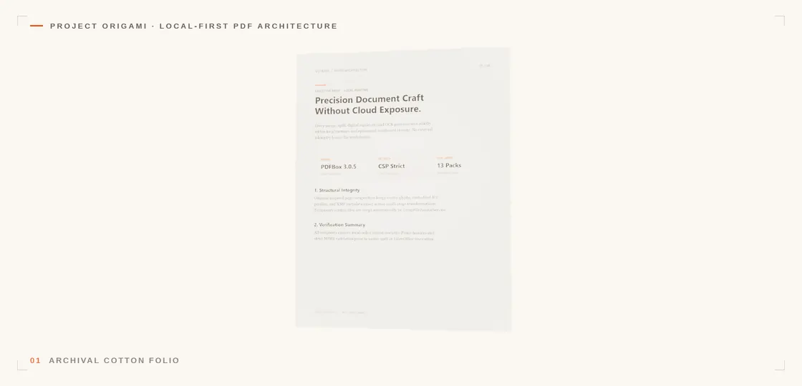
  </a>
</p>

<p align="center">
  <strong>Local-first PDF craft. Precision paper architecture.</strong><br>
  A calm, self-hosted document studio for assembling, signing, inspecting, compressing, and converting PDFs—without leaving your machine.
</p>

<p align="center">
  <a href="#03--download--quick-start"></a>
  <a href="LICENSE"></a>
  <a href="#10--freedom-by-design"></a>
  <a href="#03--download--quick-start"></a>
  <a href="#03--download--quick-start"></a>
</p>

<p align="center">
  <a href="#01--the-art-of-transformation">01 Manifesto</a> &middot;
  <a href="#02--meet-octapdf">02 Product</a> &middot;
  <a href="#03--download--quick-start">03 Quick Start</a> &middot;
  <a href="#04--a-new-way-to-work-with-documents">04 Workflows</a> &middot;
  <a href="#05--the-document-orchestra">05 Orchestra &amp; API</a> &middot;
  <a href="#06--precision-in-every-page">06 Precision</a> &middot;
  <a href="#07--the-paper-laboratory">07 Laboratory</a> &middot;
  <a href="#08--eight-arms-endless-possibilities">08 Eight Arms</a><br>
  <a href="#09--engineering-beneath-the-paper">09 Engineering</a> &middot;
  <a href="#10--freedom-by-design">10 Privacy</a> &middot;
  <a href="#11--light-meets-dark">11 Light &amp; Dark</a> &middot;
  <a href="#12--living-paper-architecture">12 Telemetry</a> &middot;
  <a href="#13--releases-builds--roadmap">13 Releases</a> &middot;
  <a href="#14--documentation--community">14 Docs</a> &middot;
  <a href="#15--the-final-fold">15 Finale</a>
</p>

---

<a id="01--the-art-of-transformation"></a>
## 01 — The Art of Transformation

Most document tools ask you to upload contracts, tax records, medical scans, and internal briefs to remote servers before a single page can be rotated or merged. **OctaPDF** returns the entire craft to your own desk.

Built on the **Paper Desk** design language—warm eggshell `#FAF7F2` daylight sheets and `#161412` obsidian-graphite dark surfaces accented in `#E8501C` terracotta—OctaPDF pairs tactile visual restraint with battle-tested local engines (`Apache PDFBox 3.0.5`, `qpdf`, `Tesseract OCR`, `LibreOffice`, and `Poppler`).

<p align="center">
  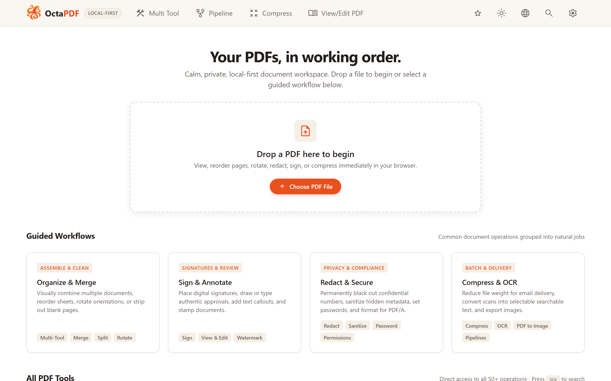
</p>

---

<a id="02--meet-octapdf"></a>
## 02 — Meet OctaPDF

<p align="center">
  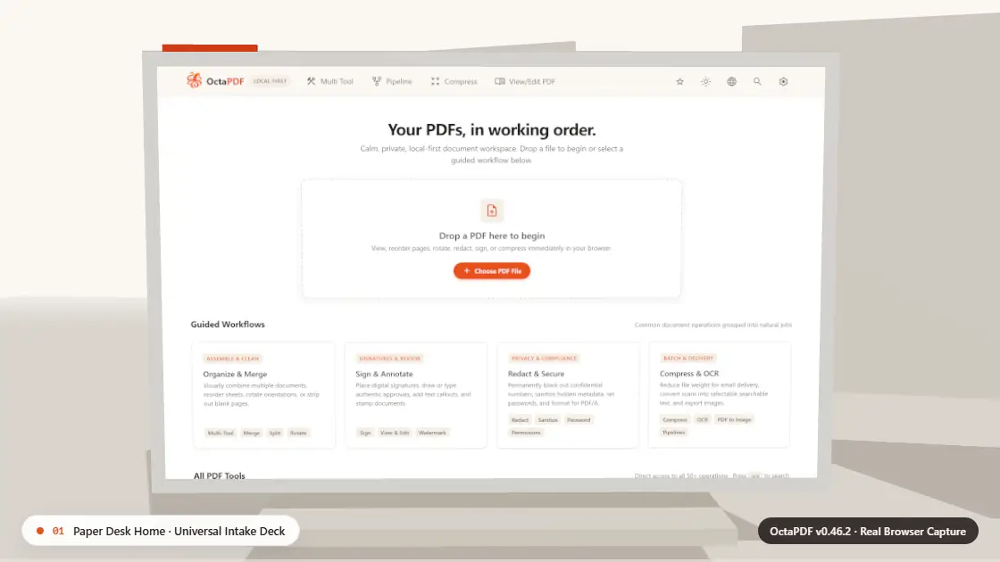
</p>

Every frame above is captured directly from the live **OctaPDF `0.46.2`** web application:

- **Universal Intake Dropzone (`home.html`)**: Drop any PDF directly onto the Paper Desk intake deck to validate `application/pdf` input and jump straight into the `/multi-tool` page organizer.
- **Command Palette (`Ctrl+K` / `⌘K` on Home)**: Opens `#paletteBackdrop` over the home workspace with 9 curated quick-jump links (`Multi-Tool`, `Sign`, `Redact`, `Compress`, `OCR`, `Merge`, `Split`, `Rotate`, and `Pipelines`).
- **Multi-Tool Canvas (`/multi-tool`)**: Visual page grid for reordering, rotating in 90° steps, duplicating, selecting page ranges, and exporting cleanly.
- **PDF.js Reader (`/view-pdf`) & Sign Studio (`/sign`)**: Thumbnail-navigated viewing alongside freehand `signature_pad` strokes, typed signatures, and image stamps placed directly onto document pages.

---

<a id="03--download--quick-start"></a>
## 03 — Download & Quick Start

<p align="center">
  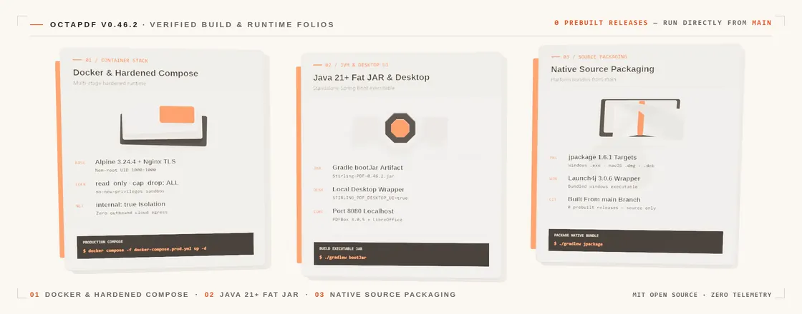
</p>

> [!NOTE]
> **Release Status:** `0` pre-built binary releases are currently published on [GitHub Releases](https://github.com/DecoyINDIA/OctaPDF/releases). Build and run directly from `main` or deploy via the hardened Docker configurations below.

### Option A — Hardened Docker Compose Stack (Recommended)

The repository includes a two-service hardened stack in [`docker-compose.prod.yml`](docker-compose.prod.yml) pairing `octapdf` (`read_only: true`, `cap_drop: ALL`, `no-new-privileges:true`, UID/GID `1000`, `tmpfs` `/tmp` & `$HOME`, isolated `internal: true` bridge network) with an `nginx:alpine` TLS reverse proxy (`nginx.conf`):

```sh
git clone https://github.com/DecoyINDIA/OctaPDF.git
cd OctaPDF
docker compose -f docker-compose.prod.yml up -d
```

Three Dockerfile profiles are provided:
- [`Dockerfile`](Dockerfile) — Alpine `3.24.4` production image with JDK 21 JRE, `qpdf`, `tesseract-ocr` (13 languages), `libreoffice` + `unoserver`, `poppler-utils`, and `weasyprint==64.1` (`weasyprint_safe.py`).
- [`Dockerfile.fat`](Dockerfile.fat) — Multi-stage Alpine `3.21.3` build with full CLI toolset.
- [`Dockerfile.ultra-lite`](Dockerfile.ultra-lite) — Minimal Alpine `3.21.3` JRE-only image (`ENDPOINTS_GROUPS_TO_REMOVE=CLI`).

### Option B — Java 21+ Source & Desktop UI

Requires **Java 21+** runtime (`sourceCompatibility = 17` in [`build.gradle`](build.gradle)):

```sh
# Build the Spring Boot fat JAR (outputs build/libs/Stirling-PDF-0.46.2.jar)
./gradlew bootJar

# Run the web workspace on http://localhost:8080
./gradlew bootRun

# Optional: launch with embedded JCEF/JavaFX Desktop UI
STIRLING_PDF_DESKTOP_UI=true java -jar build/libs/Stirling-PDF-0.46.2.jar
```

### Option C — Native Packaging from Source

Package platform installers locally via Gradle tasks defined in [`build.gradle`](build.gradle):

- **jpackage** (`.exe` / `.dmg` / `.deb`): `./gradlew jpackage` (or `./gradlew jpackageMacX64` on Intel macOS)
- **Launch4j** (Windows `.exe`): `./gradlew createExe`

---

<a id="04--a-new-way-to-work-with-documents"></a>
## 04 — A New Way to Work with Documents

OctaPDF groups its implemented tools into four clear document workflows on the Paper Desk home hub:

1. **Assemble & Clean**
   - `Multi-Tool` (`/multi-tool`), `Merge` (`/merge-pdfs`), `Split` (`/split-pages`), `Split by Chapters` (`/split-pdf-by-chapters`), `Split by Sections` (`/split-pdf-by-sections`), `Split by Size/Count` (`/split-by-size-or-count`), `Auto-Split` (`/api/v1/misc/auto-split-pdf`), `Rotate` (`/rotate-pdf`), `Crop` (`/crop`), `Rearrange / Remove Pages`, `Multi-Page Layout`, `Scale Pages`, `Overlay`, and `Remove Blank Pages` (`/api/v1/misc/remove-blanks`).
2. **Sign & Annotate**
   - `View & Edit` (`/view-pdf` via PDF.js), `Sign` (`/sign`), `Cert Sign` (`/cert-sign`), `Validate Signature` (`/validate-signature`), `Add Image`, `Add Stamp`, `Watermark`, `Page Numbers`, `Flatten`, `Remove Annotations`, `Unlock PDF Forms`, and `Compare` (`/compare`).
3. **Redact & Secure**
   - `Add / Remove Password`, `Change Permissions`, `Sanitize PDF` (`/sanitize-pdf`), `Metadata` (`/api/v1/misc/update-metadata`), `Inspect PDF Info` (`/get-info-on-pdf`), `Show JavaScript` (`/api/v1/misc/show-javascript`), and `Filter` (`/api/v1/filter/*`).
   - *Production hardening note:* `/redact` and `/auto-redact` are disabled in production via `endpoints.toRemove` (`application-prod.properties` / `docker-compose.prod.yml`). When enabled in local/dev profiles, `RedactController` draws filled overlay rectangles via PDFBox `PDPageContentStream.AppendMode.APPEND` (full glyph removal occurs only when `convertPDFToImage=true` rasterizes pages).
4. **Compress & OCR**
   - `Compress` (`/api/v1/misc/compress-pdf` via PDFBox image recompression + `qpdf`), `Decompress`, `OCR` (`/api/v1/misc/ocr-pdf` via Tesseract), `Repair` (`/api/v1/misc/repair` via `qpdf`), `Replace / Invert Color`, `Extract Images`, `Image ↔ PDF`, `PDF → PDF/A`, `PDF → Word / Presentation / Text / XML` (LibreOffice), `PDF → HTML` (`pdftohtml`), `PDF → Markdown`, and `PDF → CSV` (Tabula `1.0.5`).

---

<a id="05--the-document-orchestra"></a>
## 05 — The Document Orchestra

<p align="center">
  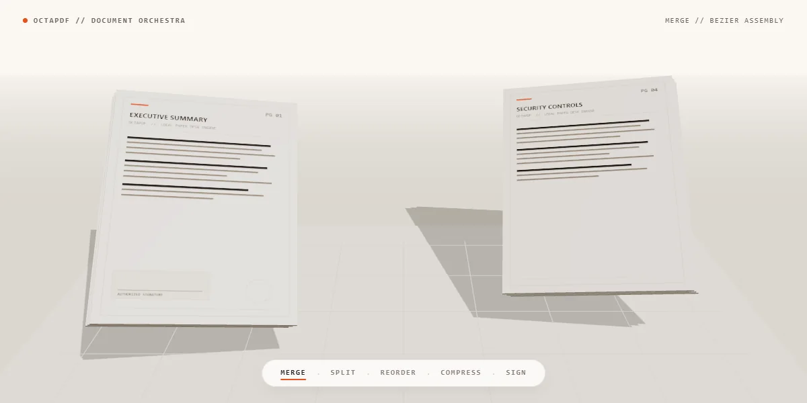
</p>

Every operation is exposed both through the Paper Desk UI and verified local REST controllers:

| Operation | Controller | Verified Endpoint | Engine |
|:---|:---|:---|:---|
| Merge PDFs | `MergeController` | `POST /api/v1/general/merge-pdfs` | Apache PDFBox `3.0.5` |
| Split Pages | `SplitPDFController` | `POST /api/v1/general/split-pages` | Apache PDFBox `3.0.5` |
| Sign Document | `SignatureController` | `POST /api/v1/general/sign/{fileName}` | Apache PDFBox `3.0.5` |
| Compress PDF | `CompressController` | `POST /api/v1/misc/compress-pdf` | PDFBox + `qpdf` |
| OCR PDF | `OCRController` | `POST /api/v1/misc/ocr-pdf` | Tesseract OCR (13 langs) |
| Repair PDF | `RepairController` | `POST /api/v1/misc/repair` | `qpdf` |
| Sanitize PDF | `SanitizeController` | `POST /api/v1/security/sanitize-pdf` | Apache PDFBox `3.0.5` |
| PDF to HTML | `ConvertPDFToHtml` | `POST /api/v1/convert/pdf/html` | Poppler `pdftohtml` |
| PDF to PDF/A | `ConvertPDFToPDFA` | `POST /api/v1/convert/pdf/pdfa` | LibreOffice / `unoserver` |

> [!TIP]
> **Hardened Prod Defaults:** `pipeline`, `html-to-pdf`, `markdown-to-pdf`, `file-to-pdf`, `redact`, and `auto-redact` are disabled in [`docker-compose.prod.yml`](docker-compose.prod.yml) and `application-prod.properties` (`ENDPOINTS_TOREMOVE`), and `system.enableUrlToPDF` defaults to `false`.

---

<a id="06--precision-in-every-page"></a>
## 06 — Precision in Every Page

<p align="center">
  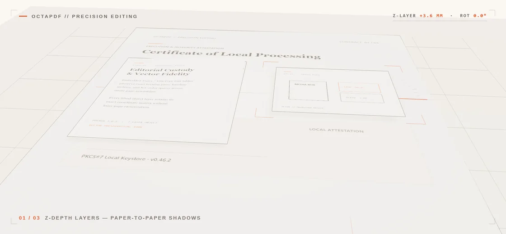
</p>

OctaPDF treats individual pages as physical sheets on a drafting table—preserving page geometry, rotation matrices, and signature placement across the client (`PDF.js`, `pdf-lib`, `signature_pad`, `interact.js`) and server (`PDFBox 3.0.5`, `BouncyCastle 1.80`).

---

<a id="07--the-paper-laboratory"></a>
## 07 — The Paper Laboratory

<p align="center">
  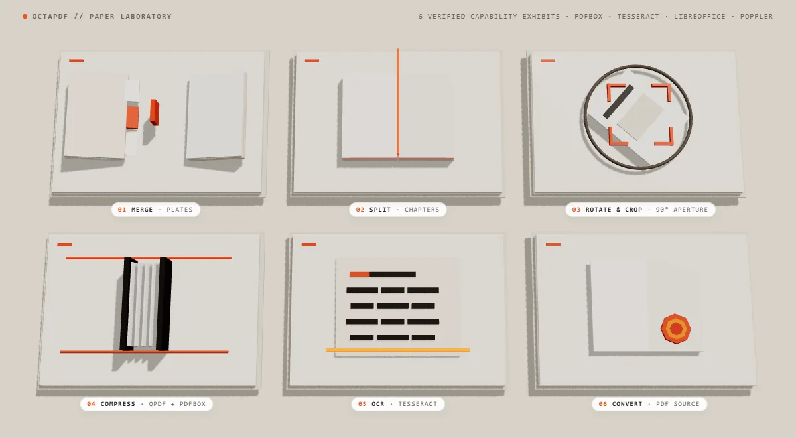
</p>

Six distinct mechanical paper transformations powered by local engines:

1. **Merge (`MergeController`)** — Interlocking page assembly via Apache PDFBox `3.0.5`.
2. **Split (`SplitPDFController`)** — Precision page-interval, size/count, and chapter separation.
3. **Rotate & Crop (`RotationController` / `CropController`)** — Exact 90° page orientation and crop-box trimming.
4. **Compress (`CompressController`)** — Image recompression and object-stream compaction via Apache PDFBox and `qpdf`.
5. **OCR (`OCRController`)** — Searchable text layers powered by `tesseract-ocr` with 13 languages baked into `Dockerfile` (`eng`, `chi_sim`, `chi_tra`, `deu`, `fra`, `por`, `spa`, `ita`, `rus`, `jpn`, `kor`, `hin`, `ara`).
6. **Convert (`ConvertPDFToPDFA` / `ConvertPDFToOffice` / `ConvertPDFToHtml`)** — Material conversions across `PDF/A`, Office formats, and HTML via LibreOffice/`unoserver` and Poppler `pdftohtml`.

---

<a id="08--eight-arms-endless-possibilities"></a>
## 08 — Eight Arms, Endless Possibilities

<p align="center">
  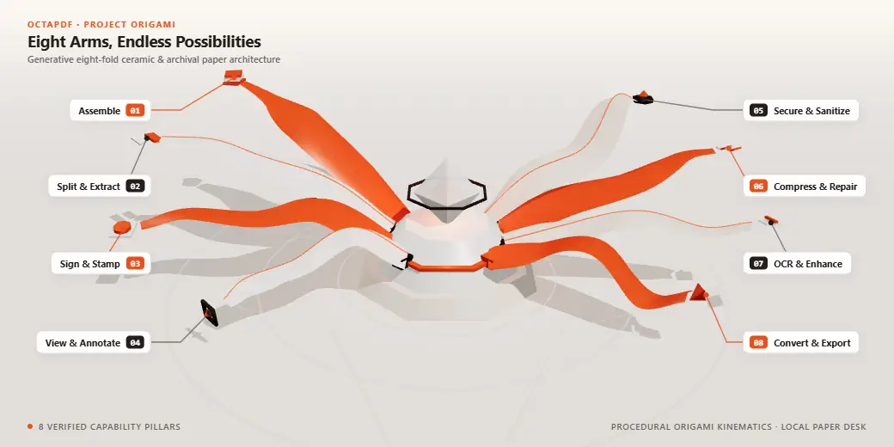
</p>

Eight sculptural origami pillars radiating from the central Paper Desk core:

| Pillar | Scope | Pillar | Scope |
|:---|:---|:---|:---|
| **01 Assemble** | Merge, multi-tool reorder, overlay, n-up | **05 Secure & Sanitize** | Passwords, permissions, cert sign, sanitize |
| **02 Split & Extract** | Page intervals, size/count, chapters, auto-split | **06 Compress & Repair** | PDFBox + `qpdf` compaction & repair |
| **03 Sign & Stamp** | `signature_pad`, certs, stamps, watermarks | **07 OCR & Enhance** | Tesseract 13-language OCR, color invert, deskew |
| **04 View & Annotate** | PDF.js viewer, flatten, forms, compare | **08 Convert & Export** | PDF/A, Word/PPTX/CSV, HTML, Markdown, Images |

---

<a id="09--engineering-beneath-the-paper"></a>
## 09 — Engineering Beneath the Paper

<p align="center">
  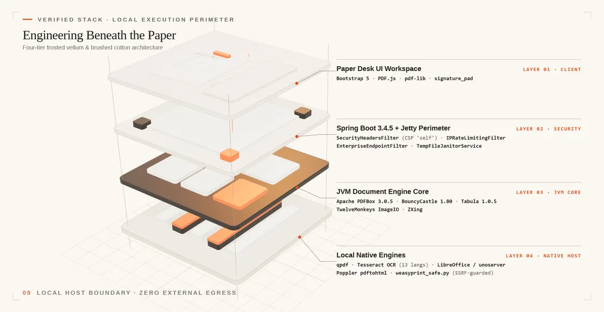
</p>

Every layer executes locally inside your host perimeter:

- **Layer 01 — Client Workspace:** `Bootstrap 5`, `jQuery`, `PDF.js`, `pdf-lib`, `signature_pad`, `jszip`, `interact.js`, plus bundled `Material Symbols Rounded` and `bootstrap-icons` (zero external Google Fonts CDN requests).
- **Layer 02 — Web & Security Perimeter:** `Spring Boot 3.4.5` on embedded **Jetty** (Tomcat excluded), `SecurityHeadersFilter`, `IPRateLimitingFilter`, `EnterpriseEndpointFilter`, and `TempFileJanitorService`.
- **Layer 03 — JVM Document Core:** `Apache PDFBox 3.0.5` (`pdfbox`, `preflight`, `xmpbox`), `BouncyCastle 1.80`, `Tabula 1.0.5`, `TwelveMonkeys ImageIO 3.12.0`, `ZXing 3.5.3`, `JBIG2 ImageIO 3.0.4`, `Batik 1.19`, `OWASP HTML Sanitizer`, and `Bucket4j 8.14.0`.
- **Layer 04 — Local Native Engines:** `qpdf`, `tesseract-ocr` (13 baked languages), `libreoffice` + `unoserver 3.7` (port `2003`, supervised by `scripts/supervise.sh`), `poppler-utils` (`pdftohtml`), and `weasyprint 64.1` wrapped by `scripts/weasyprint_safe.py`.

---

<a id="10--freedom-by-design"></a>
## 10 — Freedom by Design

<p align="center">
  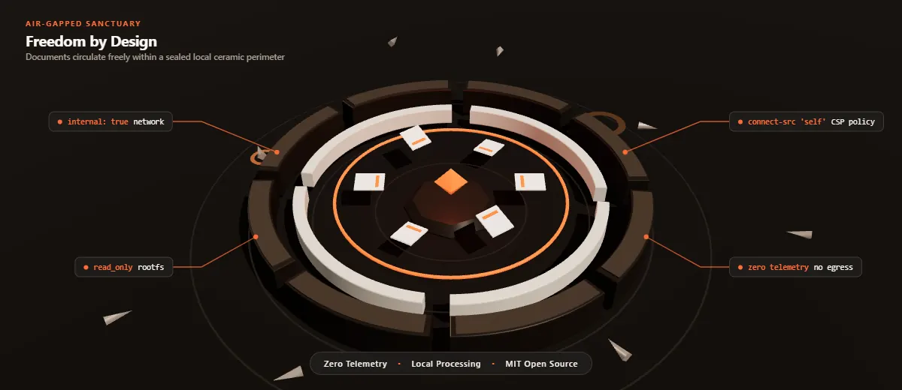
</p>

Verified privacy and hardening controls present in the codebase:

- **Telemetry Permanently Removed:** PostHog SDK/keys and the upstream `pixel.stirlingpdf.com` tracking pixel are completely stripped from `src/`. `scripts/download-security-jar.sh` is a no-op stub and `scripts/init.sh` executes zero runtime `apk add` downloads.
- **Optional External Calls Gated Off by Default:** `githubVersion.js` (`system.showUpdate=false`), `KeygenLicenseVerifier` (`premium.enabled=false`), and `GoogleDrive` (`premium.proFeatures.googleDrive.enabled=false`) remain inactive unless explicitly configured.
- **Single-Source HTTP Security Headers (`SecurityHeadersFilter`):** Enforces `default-src 'self'; object-src 'none'; frame-ancestors 'none'; connect-src 'self'`, `HSTS`, `X-Frame-Options: DENY`, `X-Content-Type-Options: nosniff`, `Referrer-Policy`, and `Permissions-Policy`.
- **Abuse & Temp-File Controls:** `IPRateLimitingFilter` (`60 req/min` general, `10 req/min` heavy with CIDR `trustedProxies`), `EnterpriseEndpointFilter` (exposes `/actuator/health` only, suppresses stack traces, caps uploads at `100 MB` / `250 MB` request / `1,000` pages / `50` files), `TempFileJanitorService` (reaps temp files `> 30 min` every `10 min`), and `weasyprint_safe.py` + `CustomHtmlSanitizer` + `OfficeDocumentSanitizer` SSRF guards.
- **Container Lockdown (`docker-compose.prod.yml`):** `read_only: true`, `cap_drop: ALL`, `no-new-privileges:true`, unprivileged UID/GID `1000`, `tmpfs` mounts, and `internal: true` bridge network blocking WAN egress.

---

<a id="11--light-meets-dark"></a>
## 11 — Light Meets Dark

<p align="center">
  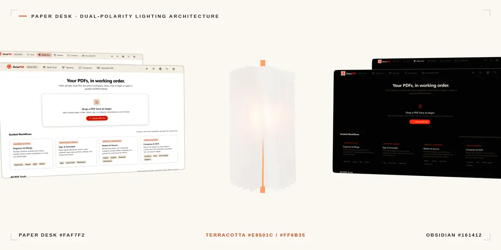
</p>

| Token | Paper Desk Light (`theme.light.css`) | Obsidian Dark (`theme.dark.css`) | Semantic Role |
|:---|:---|:---|:---|
| `--octapdf-bg-canvas` | `#FAF7F2` | `#161412` | Primary workspace canvas |
| `--octapdf-bg-surface` | `#FFFFFF` | `#1F1C19` | Elevated document cards & modals |
| `--octapdf-bg-surface-subtle` | `#F5EFE6` | `#292521` | Recessed trays & secondary panels |
| `--octapdf-text-main` | `#241E1B` | `#F5EFE6` | Primary headings & body ink |
| `--octapdf-text-muted` | `#6E645D` | `#A89E94` | Secondary labels & metadata |
| `--octapdf-border-subtle` | `#E8E2D8` | `#36312B` | Paper edges & hairline dividers |
| Primary Accent | `#E8501C` | `#FF6B35` | Wordmark accent, focus & active controls |

<details>
<summary><strong>Explore Authentic OctaPDF 0.46.2 Light &amp; Dark Mode UI Captures</strong></summary>

<br>

| Light Mode (`#FAF7F2`) | Dark Mode (`#161412`) |
|:---:|:---:|
| <br><sub>Home &amp; Universal Intake Deck (Light)</sub> | 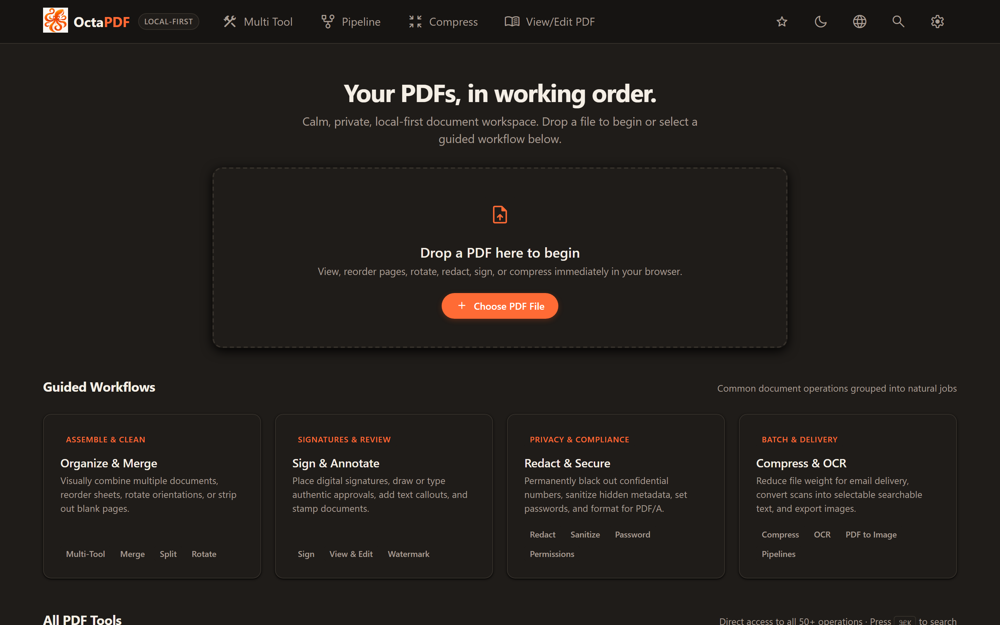<br><sub>Home &amp; Universal Intake Deck (Dark)</sub> |
| 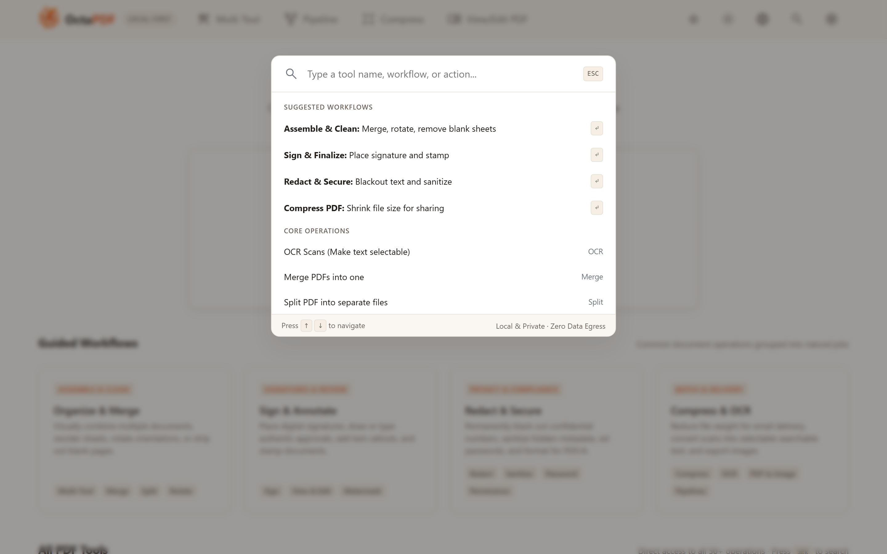<br><sub>Command Palette <code>Ctrl+K</code> (Light)</sub> | 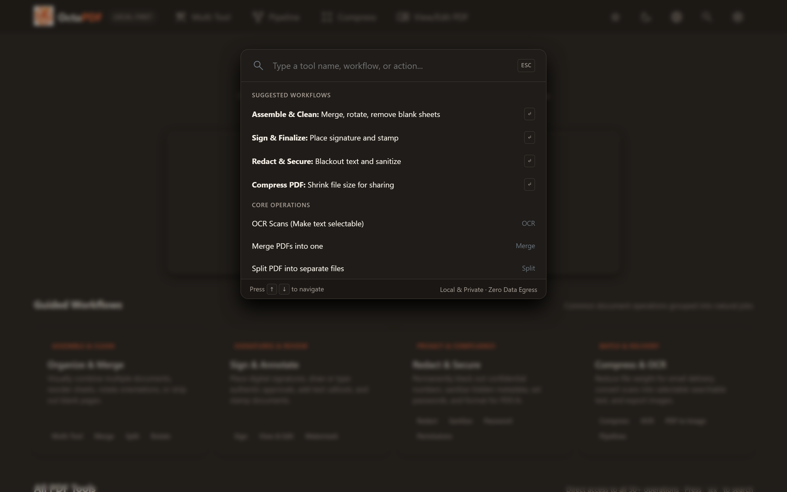<br><sub>Command Palette <code>Ctrl+K</code> (Dark)</sub> |
| 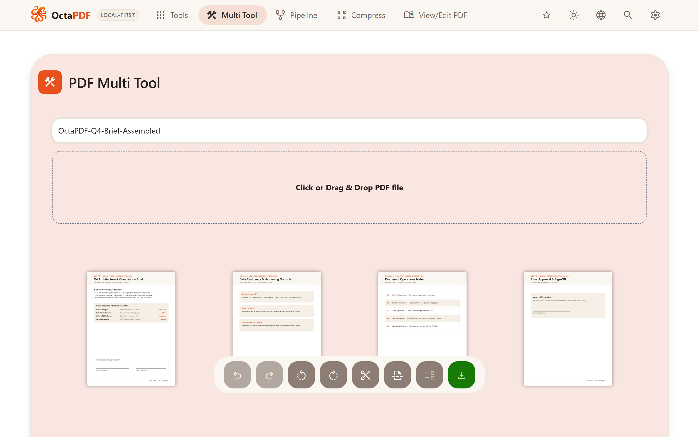<br><sub>Multi-Tool Page Canvas (Light)</sub> | 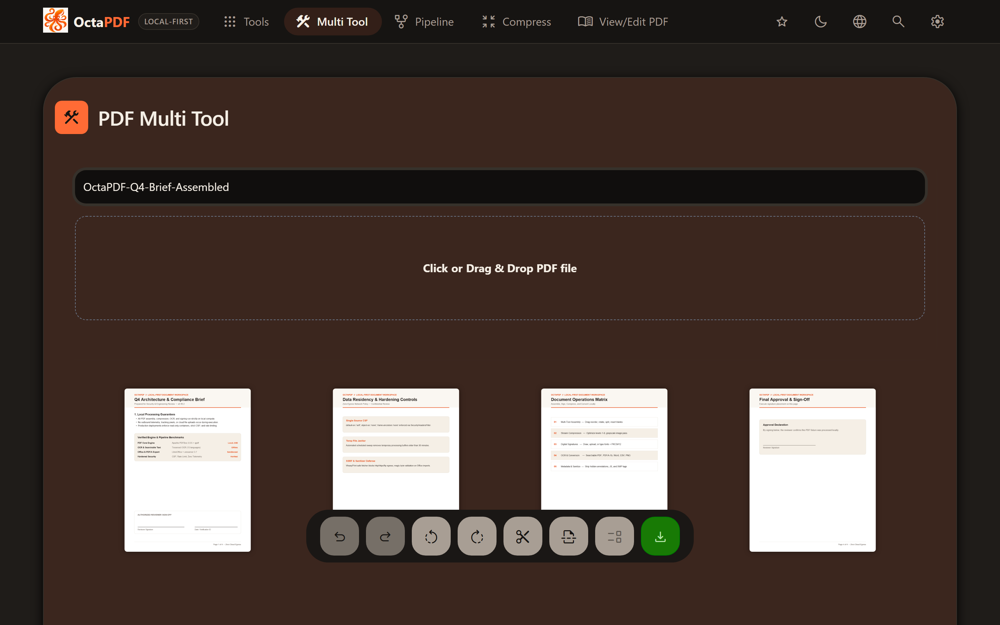<br><sub>Multi-Tool Page Canvas (Dark)</sub> |
| 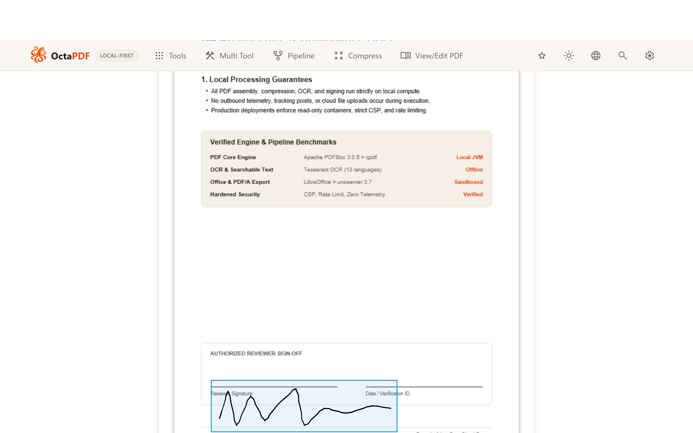<br><sub>Signature Placement Studio (Light)</sub> | 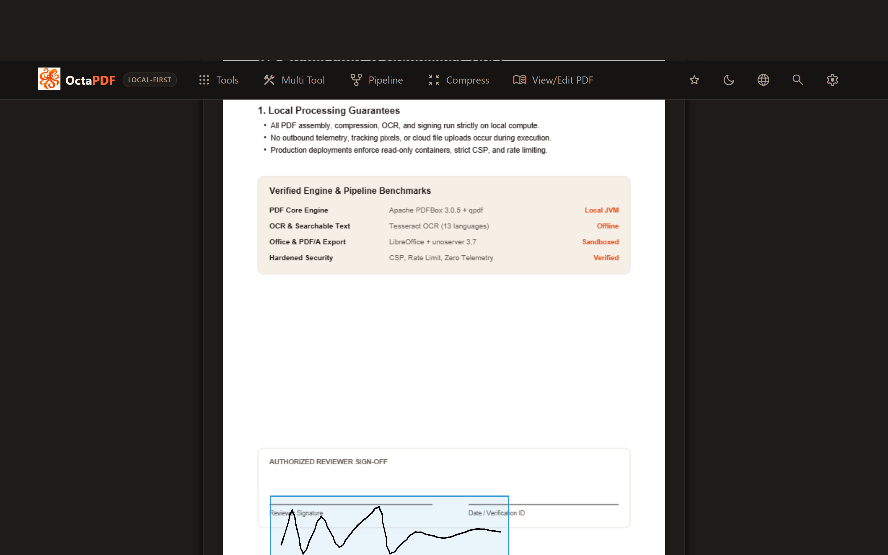<br><sub>Signature Placement Studio (Dark)</sub> |
| 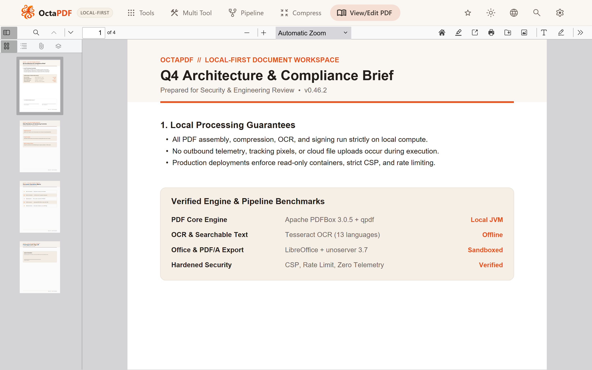<br><sub>PDF.js Document Viewer (Light)</sub> | 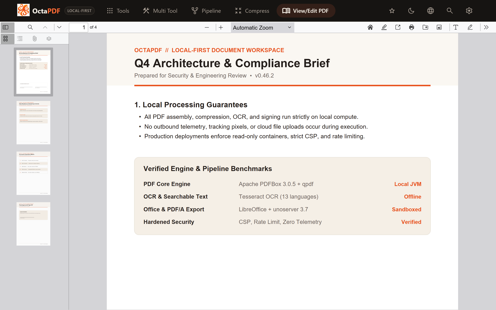<br><sub>PDF.js Document Viewer (Dark)</sub> |
| 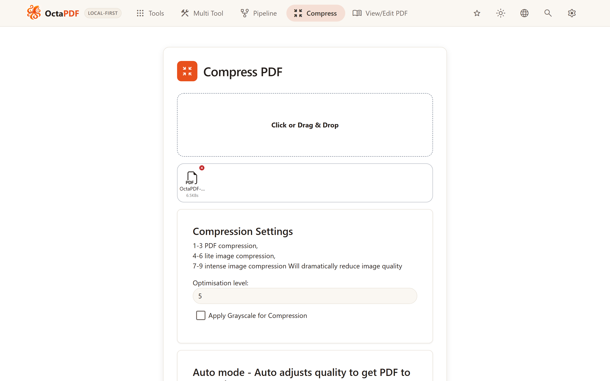<br><sub>PDF Compression Controls (Light)</sub> | 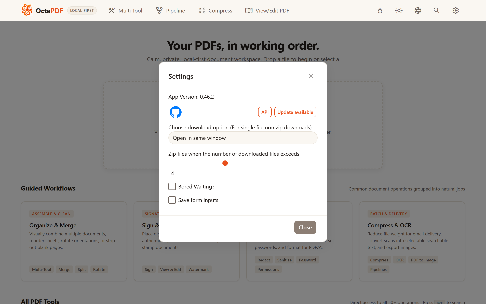<br><sub>Settings Modal — OctaPDF <code>0.46.2</code></sub> |

</details>

---

<a id="12--living-paper-architecture"></a>
## 12 — Living Paper Architecture

<p align="center">
  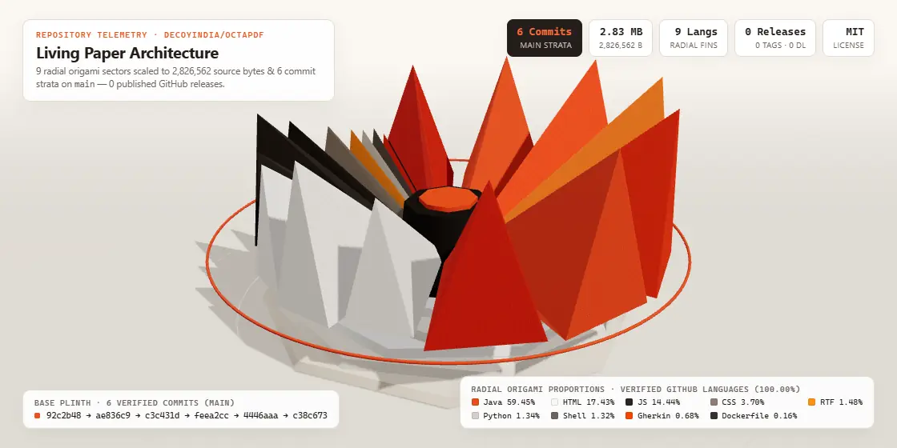
</p>

Verified repository metrics for [`DecoyINDIA/OctaPDF`](https://github.com/DecoyINDIA/OctaPDF) (`main` branch):

| Metric | Verified Value | Language Breakdown (`2,826,562` Bytes) | Share |
|:---|:---|:---|:---|
| **Default Branch** | `main` (`6` commits) | Java | `59.45%` (`1,680,528` B) |
| **Stars / Forks / Watchers** | `0` / `0` / `0` | HTML | `17.43%` (`492,643` B) |
| **Open Issues** | `0` | JavaScript | `14.44%` (`408,121` B) |
| **Published GitHub Releases** | `0` (`0` assets, `0` downloads) | CSS | `3.70%` (`104,565` B) |
| **License** | MIT ([`LICENSE`](LICENSE)) | RTF / Python / Shell / Gherkin / Dockerfile | `1.48%` / `1.34%` / `1.32%` / `0.68%` / `0.16%` |

---

<a id="13--releases-builds--roadmap"></a>
## 13 — Releases, Builds & Roadmap

- **Current Baseline:** `v0.46.2` source baseline (`build.gradle`). No prebuilt GitHub release artifacts are published on `/releases` yet—deploy from source via `./gradlew bootJar` or `docker-compose.prod.yml`.
- **Production Roadmap:** Track completed hardening work (`SEC-01`..`SEC-11`, `D1`–`D8` architecture decisions) and deferred items—such as `P2-03` (renaming the Gradle artifact output from `Stirling-PDF-0.46.2.jar` to `OctaPDF-0.46.2.jar`)—in [`docs/PRODUCTION_ROADMAP.md`](docs/PRODUCTION_ROADMAP.md).
- **Operations & QA:** See [`docs/DEPLOYMENT.md`](docs/DEPLOYMENT.md), [`docs/RUNBOOK.md`](docs/RUNBOOK.md), and [`docs/QA_MATRIX.md`](docs/QA_MATRIX.md).

---

<a id="14--documentation--community"></a>
## 14 — Documentation & Community

- **Architecture & Development:** [`DeveloperGuide.md`](DeveloperGuide.md) · [`CONTRIBUTING.md`](CONTRIBUTING.md) · [`DATABASE.md`](DATABASE.md) · [`USERS.md`](USERS.md)
- **Localization & OCR:** [`HowToAddNewLanguage.md`](HowToAddNewLanguage.md) · [`HowToUseOCR.md`](HowToUseOCR.md)
- **Brand & Security:** [`docs/OctaPDF-Logo-Guidelines.pdf`](docs/OctaPDF-Logo-Guidelines.pdf) · [`SECURITY.md`](SECURITY.md)
- **Licensing & Attribution:**
  - Licensed under the [MIT License](LICENSE).
  - Maintained by [XolverLabs (`DecoyINDIA`)](https://github.com/DecoyINDIA) & contributors.
  - Forked from and based on [Stirling-PDF](https://github.com/Stirling-Tools/Stirling-PDF) `v0.46.2` by Anthony Stirling & Stirling Tools.
  - Third-party component licenses are cataloged in [`src/main/resources/static/3rdPartyLicenses.json`](src/main/resources/static/3rdPartyLicenses.json).

---

<a id="15--the-final-fold"></a>
## 15 — The Final Fold

<p align="center">
  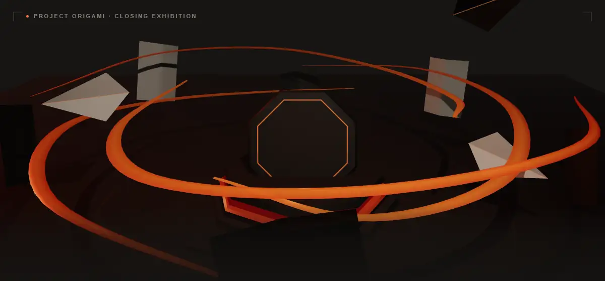
</p>

<p align="center">
  <strong>OctaPDF · Project Origami</strong><br>
  <sub>Zero Telemetry &middot; Local Processing &middot; MIT Open Source</sub>
</p>
