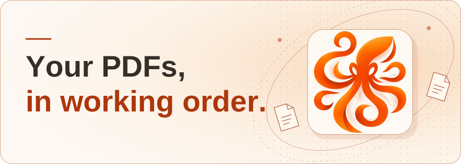

# OctaPDF



OctaPDF is a self-hosted PDF reader and editor. Mark up a draft, turn a stack of scans into searchable documents,
or assemble a packet from several PDFs in your browser. Run it on your own machine or server.

[Everyday tools](#everyday-pdf-tools) · [Standout workflows](#standout-workflows) · [Run OctaPDF](#run-octapdf)

## Everyday PDF tools

- **Read and mark up.** Search a PDF, draw on pages, add text or images, and place a signature.
- **Organize pages visually.** Merge documents, reorder and rotate pages, remove extras, or extract the pages you need.
- **Convert and compress.** Create PDFs from images and Office files, export PDFs to images, or shrink a file before sharing it.
- **Prepare documents to share.** Add passwords, redact text, apply watermarks, or flatten forms and annotations.

## Standout workflows

- **Split a stack of scans in one pass.** Put printed divider sheets between documents before scanning.
  Auto Split detects the dividers and creates individual PDFs from the batch.
- **Make scans searchable.** Run OCR on scanned contracts or archived paperwork so you can find and copy text.
- **Compare revisions side by side.** See which text changed between two PDFs, such as updated terms in a revised agreement.
- **Repeat a workflow with Pipelines.** Save a sequence such as removing blank pages, running OCR, and compressing the result.
  Reuse it on future batches or call the REST API from a script.

## Run OctaPDF

From this checkout, start the app with the Gradle wrapper using JDK 21.

```sh
./gradlew bootRun
```

On Windows, run `gradlew.bat bootRun` from Command Prompt or `.\gradlew.bat bootRun` from PowerShell.
Open <http://localhost:8080> when the app starts. Some tools require locally installed utilities, such as Tesseract
for OCR, LibreOffice for Office conversions, and qpdf for compression. See the setup and configuration guides.
[Developer Guide](DeveloperGuide.md) · [Upstream documentation](https://docs.stirlingpdf.com)

OctaPDF is maintained by XolverLabs (DecoyINDIA) and based on Stirling-PDF v0.46.2. Stirling Tools publishes the
upstream Docker images and hosted services. [Maintainer](https://github.com/DecoyINDIA) ·
[Upstream release](https://github.com/Stirling-Tools/Stirling-PDF/releases/tag/v0.46.2) ·
[MIT license](LICENSE) · [OctaPDF logo guidelines](docs/OctaPDF-Logo-Guidelines.pdf)

## Supported Languages

Language coverage inherited from Stirling-PDF v0.46.2.

| Language                                     | Progress                               |
| -------------------------------------------- | -------------------------------------- |
| Arabic (العربية) (ar_AR)                        |    |
| Azerbaijani (Azərbaycan Dili) (az_AZ)        |    |
| Basque (Euskara) (eu_ES)                     |    |
| Bulgarian (Български) (bg_BG)                |    |
| Catalan (Català) (ca_CA)                     |    |
| Croatian (Hrvatski) (hr_HR)                  |    |
| Czech (Česky) (cs_CZ)                        |    |
| Danish (Dansk) (da_DK)                       |    |
| Dutch (Nederlands) (nl_NL)                   |    |
| English (English) (en_GB)                    |  |
| English (US) (en_US)                         |  |
| French (Français) (fr_FR)                    |    |
| German (Deutsch) (de_DE)                     |    |
| Greek (Ελληνικά) (el_GR)                     |    |
| Hindi (हिंदी) (hi_IN)                          |    |
| Hungarian (Magyar) (hu_HU)                   |    |
| Indonesian (Bahasa Indonesia) (id_ID)        |    |
| Irish (Gaeilge) (ga_IE)                      |    |
| Italian (Italiano) (it_IT)                   |    |
| Japanese (日本語) (ja_JP)                    |    |
| Korean (한국어) (ko_KR)                      |    |
| Norwegian (Norsk) (no_NB)                    |    |
| Persian (فارسی) (fa_IR)                      |    |
| Polish (Polski) (pl_PL)                      |    |
| Portuguese (Português) (pt_PT)               |    |
| Portuguese Brazilian (Português) (pt_BR)     |    |
| Romanian (Română) (ro_RO)                    |    |
| Russian (Русский) (ru_RU)                    |    |
| Serbian Latin alphabet (Srpski) (sr_LATN_RS) |    |
| Simplified Chinese (简体中文) (zh_CN)         |    |
| Slovakian (Slovensky) (sk_SK)                |    |
| Slovenian (Slovenščina) (sl_SI)              |    |
| Spanish (Español) (es_ES)                    |    |
| Swedish (Svenska) (sv_SE)                    |    |
| Thai (ไทย) (th_TH)                           |    |
| Tibetan (བོད་ཡིག་) (zh_BO)                     |  |
| Traditional Chinese (繁體中文) (zh_TW)        |    |
| Turkish (Türkçe) (tr_TR)                     |    |
| Ukrainian (Українська) (uk_UA)               |    |
| Vietnamese (Tiếng Việt) (vi_VN)              |    |
| Malayalam (മലയാളം) (ml_ML)              |    |

## Stirling PDF Enterprise

Stirling PDF offers an Enterprise edition of its software. This is the same great software but with added features, support and comforts.
Check out our [Enterprise docs](https://docs.stirlingpdf.com/Pro)


## 🤝 Looking to contribute?

Join our community:
- [Contribution Guidelines](CONTRIBUTING.md)
- [Translation Guide (How to add custom languages)](HowToAddNewLanguage.md)
- [Issue Tracker](https://github.com/Stirling-Tools/Stirling-PDF/issues)
- [Discord Community](https://discord.gg/HYmhKj45pU)
- [Developer Guide](DeveloperGuide.md)
